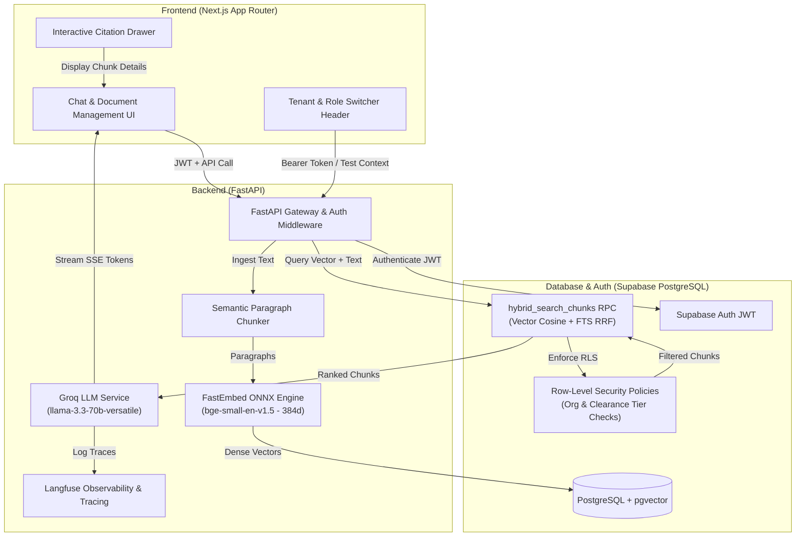

# Multi-Tenant Enterprise RAG System with Supabase RLS & Hybrid Search


A production-grade, zero-cost, multi-tenant enterprise Retrieval-Augmented Generation (RAG) system featuring **database-level Row-Level Security (RLS)** in PostgreSQL, local ONNX embeddings (`BAAI/bge-small-en-v1.5`), Reciprocal Rank Fusion (RRF) hybrid search, Groq LLM streaming (`llama-3.3-70b-versatile`), Langfuse observability, and a Next.js client with interactive citation inspection.

---

## 🏗️ System Architecture



---

## ⚡ Why This Beats Standard RAG

| Feature | Standard RAG | Enterprise Multi-Tenant RAG (This Architecture) |
| :--- | :--- | :--- |
| **Multi-Tenancy Security** | Application-level filtering (`WHERE org_id = ...` in Python code). Vulnerable to code bugs and prompt injection attacks. | **Database-Level Row-Level Security (RLS)** in PostgreSQL. Security policies run directly inside Postgres via `auth.uid()`. Un-authorized chunks cannot be leaked even if code is flawed. |
| **Search Quality** | Single vector search or basic keyword search. Misses exact acronyms or specific term matches. | **Reciprocal Rank Fusion (RRF) Hybrid Search**. Merges HNSW dense vector cosine similarity with Postgres Full-Text Search (`tsvector` GIN index) in a single database function. |
| **Inference Cost** | Paid embedding API calls ($0.02 - $0.10 per 1M tokens with OpenAI or Cohere). | **$0 Inference Cost**. Uses `fastembed` with `BAAI/bge-small-en-v1.5` (384 dimensions) running locally inside FastAPI via ONNX Runtime. |
| **Observability** | Console print statements or no tracing. | **Full Tracing with Langfuse**. Captures prompt tokens, completion tokens, latency, similarity scores, and retrieved chunk metadata per user query. |
| **Grounded Citations** | Hallucination-prone LLM answers without source verification. | **Strict Grounding & Interactive Citation Drawer**. Answers require `[CHUNK-1]` inline references. Clicking a citation opens a drawer with exact chunk text, document title, and access clearance level. |

---

## 📁 Repository Structure

```
Multi_tenant_knowledge_hub/
├── supabase/
│   └── migrations/
│       └── 01_init.sql           # Complete schema, pgvector/HNSW/GIN indexes, RLS policies, RRF RPC
├── backend/
│   ├── app/
│   │   ├── main.py               # FastAPI app entrypoint with CORS
│   │   ├── config.py             # Pydantic BaseSettings environment manager
│   │   ├── auth.py               # Supabase JWT & user context dependency
│   │   ├── services/
│   │   │   ├── chunking.py       # Semantic paragraph & markdown chunker (~400 tokens)
│   │   │   ├── embedding.py      # FastEmbed BAAI/bge-small-en-v1.5 (ONNX 384d)
│   │   │   ├── rag.py            # Groq SDK LLM call with strict citation prompt & streaming
│   │   │   └── observability.py  # Langfuse SDK tracing wrapper
│   │   └── routers/
│   │       ├── documents.py      # File upload (.txt, .md, .pdf), chunking & batch insertion
│   │       └── chat.py           # Hybrid retrieval RPC + Groq streaming SSE endpoint
│   ├── seed.py                   # Seeding script for test orgs, users, and documents
│   ├── requirements.txt
│   └── Dockerfile
├── frontend/
│   ├── src/
│   │   ├── app/
│   │   │   ├── page.tsx          # Main Dashboard
│   │   │   ├── layout.tsx
│   │   │   └── globals.css
│   │   ├── components/
│   │   │   ├── TenantSwitcher.tsx # Live RLS Persona & Role switcher header
│   │   │   ├── DocumentManager.tsx# Drag & drop upload dropzone & clearance selector
│   │   │   ├── ChatWorkspace.tsx # Streaming SSE chat workspace with inline citation pills
│   │   │   └── CitationDrawer.tsx# Slide-out citation detail drawer
│   │   └── lib/
│   │       ├── types.ts          # TypeScript interfaces
│   │       └── supabase.ts       # Supabase browser client
│   ├── package.json
│   ├── next.config.js
│   └── tailwind.config.js
├── render.yaml                   # Render web service deployment configuration
└── README.md
```

---

## 🛠️ Environment Variables Configuration

Copy `.env.example` to `.env` and configure your API keys:

```bash
# Supabase Configuration
SUPABASE_URL=https://your-project.supabase.co
SUPABASE_ANON_KEY=your-anon-key
SUPABASE_SERVICE_ROLE_KEY=your-service-role-key

# Groq LLM Configuration
GROQ_API_KEY=gsk_your_groq_api_key
GROQ_MODEL=llama-3.3-70b-versatile

# Langfuse Observability
LANGFUSE_PUBLIC_KEY=pk-lf-...
LANGFUSE_SECRET_KEY=sk-lf-...
LANGFUSE_HOST=https://cloud.langfuse.com
```

---

## 🚀 Quickstart: Local Development

### 1. Database Setup (Supabase)
1. Create a free project on [Supabase](https://supabase.com).
2. Open the SQL Editor in Supabase Dashboard and run `supabase/migrations/01_init.sql`.

### 2. Backend Setup
```bash
cd backend
python -m venv venv
# On Windows:
venv\Scripts\activate
# On Linux/macOS:
source venv/bin/activate

pip install -r requirements.txt

# Run Database Seeder (Populates test orgs & sample document chunks with embeddings)
python seed.py

# Start FastAPI server
uvicorn app.main:app --reload --port 8000
```

### 3. Frontend Setup
```bash
cd frontend
npm install
npm run dev
```
Open [http://localhost:3000](http://localhost:3000) in your browser.

---

## ☁️ One-Click Production Deployment Guide

### 1. Supabase (Database & Storage)
- Apply `supabase/migrations/01_init.sql` using Supabase CLI or SQL Editor.

### 2. Render / Railway (Backend API)
- Connect your GitHub repository to [Render](https://render.com).
- Select **New Web Service** and point to `render.yaml` or build from `backend/Dockerfile`.
- Set Environment Variables: `SUPABASE_URL`, `SUPABASE_ANON_KEY`, `GROQ_API_KEY`, `LANGFUSE_PUBLIC_KEY`, `LANGFUSE_SECRET_KEY`.

### 3. Vercel (Frontend)
- Deploy `frontend/` directory to [Vercel](https://vercel.com).
- Add Environment Variable `NEXT_PUBLIC_BACKEND_URL` pointing to your deployed Render URL (e.g. `https://multi-tenant-rag-backend.onrender.com`).

---

## 🔒 Row-Level Security (RLS) Enforcement Matrix

| User Persona | Role | Organization | Public Chunks | Internal Chunks | Confidential Chunks |
| :--- | :--- | :--- | :---: | :---: | :---: |
| **Alice Admin** | `admin` | Acme Corp | ✅ Allowed | ✅ Allowed | ✅ Allowed |
| **Bob Manager** | `manager` | Acme Corp | ✅ Allowed | ✅ Allowed | ✅ Allowed |
| **Charlie Member** | `member` | Acme Corp | ✅ Allowed | ✅ Allowed | ❌ Blocked by Postgres RLS |
| **David Globex** | `admin` | Globex Inc | ❌ Blocked (Diff Org) | ❌ Blocked (Diff Org) | ❌ Blocked (Diff Org) |

---

## 📜 License
MIT License. Built for production-grade enterprise RAG deployments.
